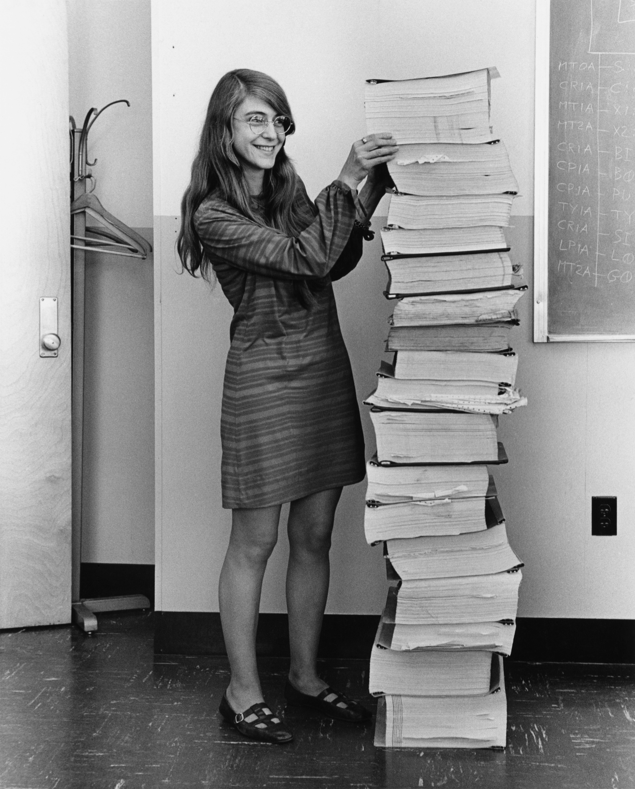
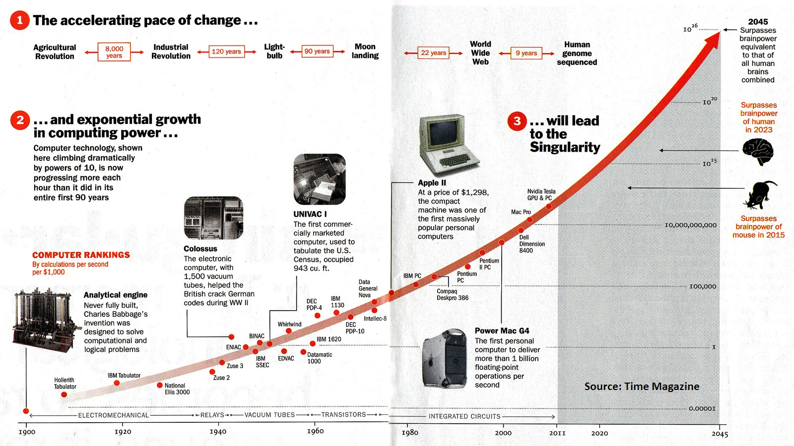

# Agency in Careers

Taking inventory the past, present, and future of Software Development, and what it might mean to students about to enter the field.

ESOF-423 · Daniel DeFrance · October, 2026

## 'Software Engineering' Begins
In 1969, when Margaret Hamilton (1936–2026) was leading software development for NASA's Apollo program at MIT, the field of Computer Science and Software Engineering were not yet considered professions. She would to change that.

Margaret Hamilton in 1969 with printed source code she and her team developed for the Apollo missions.

> During the early days of Apollo, software was not taken as seriously as other engineering disciplines. ... It was out of desperation I came up with the term \[Software Engineering\], to say: “Hey, we’re engineering too.” It was an ongoing joke for a long time.
>
> — Margaret Hamilton, The Guardian 2019.

## 1965 to 2025: The Pace of Technology

The word "computer" was came to mean a machine, and not a human, as it had meant in the 1940s and 50s. The technology improved exponetially over time.

John von Neumann had already noticed this and had even speculated on the redoubling progress of technology approaching a 'singularity'. A young Gorden Moore, who would go on to co-found Intel, put numbers to the phenomonon.

> The complexity for minimum component costs has increased at a rate of roughly a factor of two per year.
>
> — Gordon Moore, Cramming More Components onto Integrated Circuits 1965.

Moore predicted that this rate would persist for at least another decade. It only began to years later, since the features comprising modern transistors are now measured in a few dozen silicon atoms across.

Mathmatician and Turing collegue I. J. Good (also the A.I. advisor on *2001: A Space Odyssey*) imagined an "ultraintelligent machine be defined as a machine that can far surpass all the intellectual activities of any man...""

> ...there would then unquestionably be an 'intelligence explosion,' and the intelligence of man would be left far behind... Thus the first ultraintelligent machine is the last invention that man need ever make, provided that the machine is docile enough to tell us how to keep it under control.
>
> — I. J. Good, Speculations Concerning the First Ultraintelligent Machine. 1965.

That same year, a 16 year old Ray Kurzwiel went on the CBS TV show, *I've Got a Secret*, to show the world a piano composition generated by his A.I. program.

> I designed and built an electronic computer. The computer wrote the music I just played.
>
> — Ray Kurzweil, I've Got A Secret. 1965.

Kurzweil has had an illustrious career as an inventor and computer scientist ever since, but became even more famous as a futurist with an uncanny knack for predicting technological events that sound outlandish. The predictions very often occur, and do so remarkably close to schedule. He explains his success with his theory of Accelerating Returns: that progress in technology can accelerate even beyond a fixed exponential rate. 

Time Magazine chart of Ray Kurzwiel's Law of Accelerating Returns. Photograph: Time Magazine
